# MicroPOS

Point of sale system for small shops. A pnpm monorepo with shared TypeScript business logic and separate desktop, mobile and backend apps.

## Preview

### Desktop

| | |
| --- | --- |
| 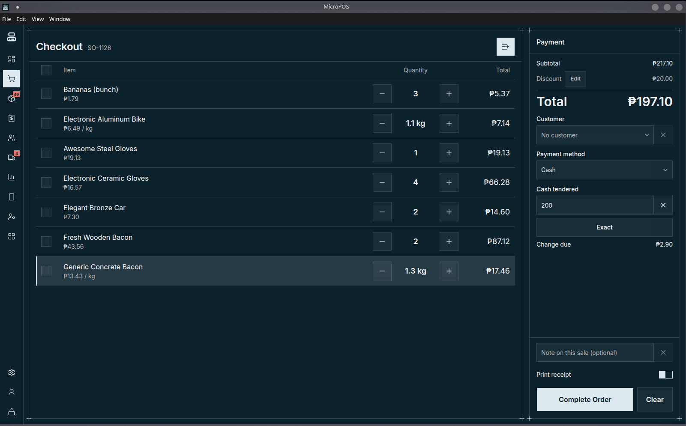 Checkout | 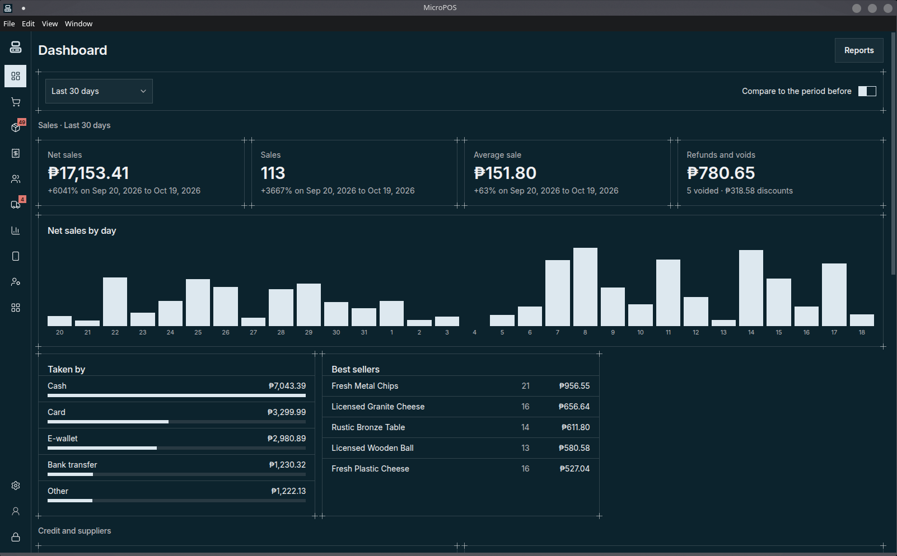 Dashboard |
| 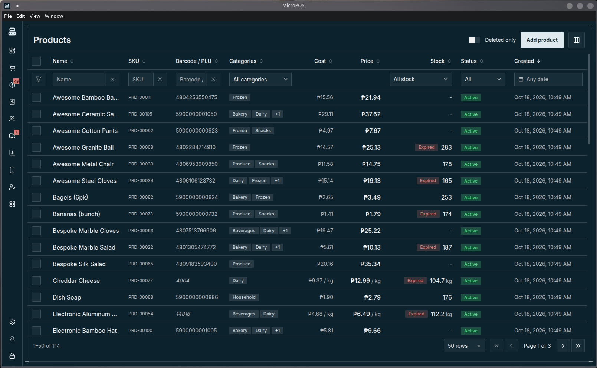 Products | 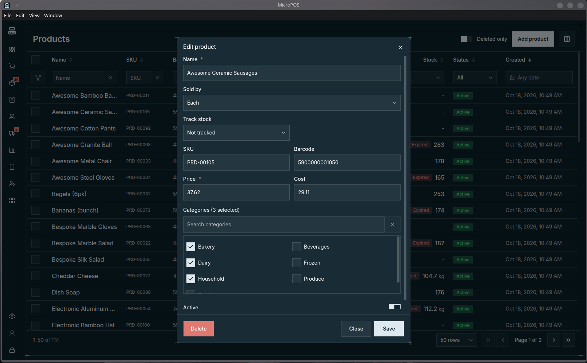 Edit product |
| 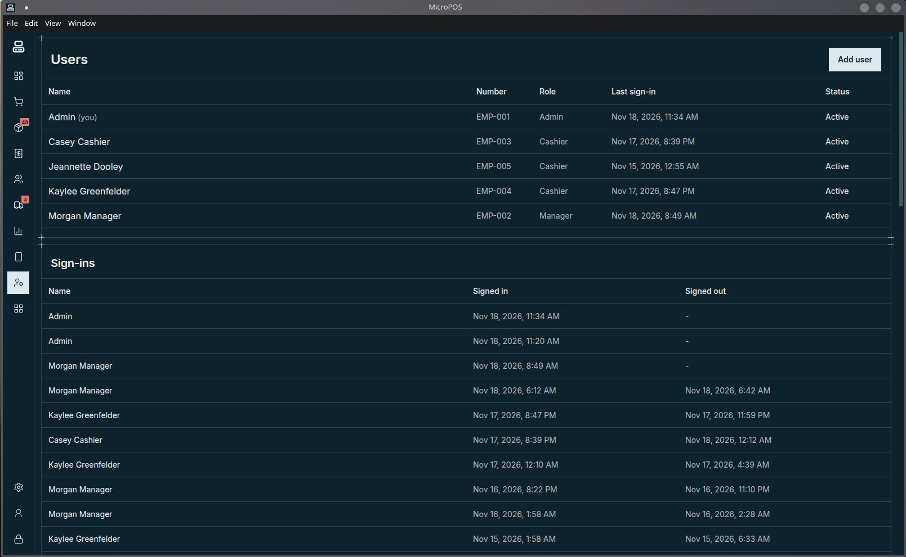 Users and sign-ins | 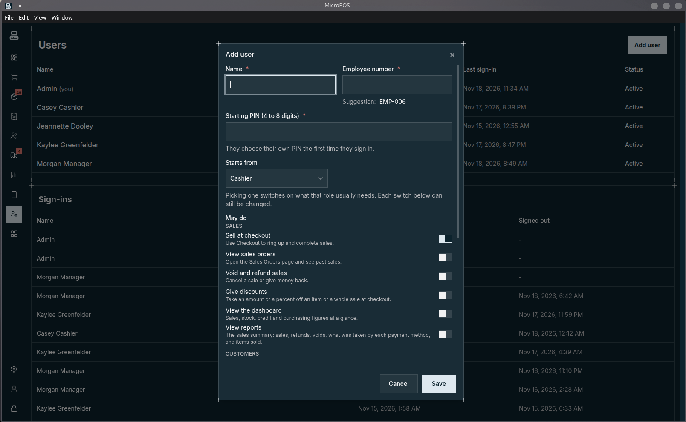 Add user with permissions |
| 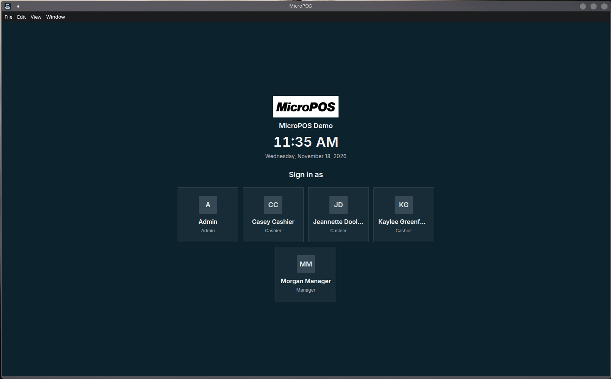 Sign in | 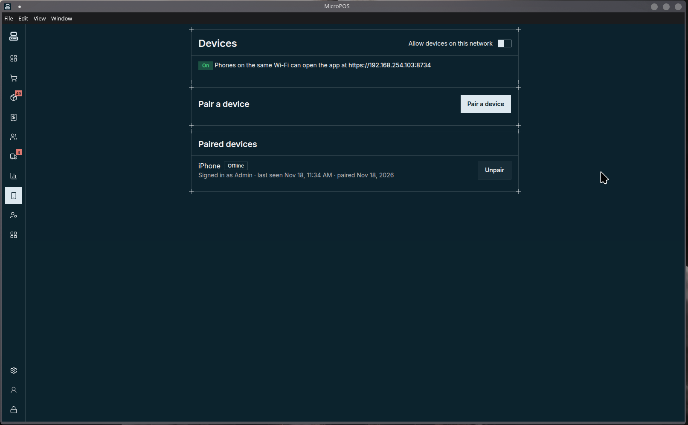 Devices on the local network |

<p align="center">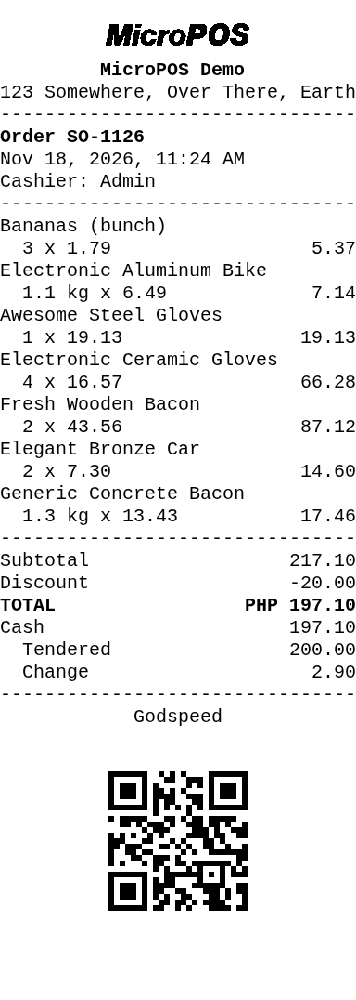<br>Receipt</p>

### Mobile browser

Phones on the same Wi-Fi open the app from the desktop's LAN server.

<p align="center">
  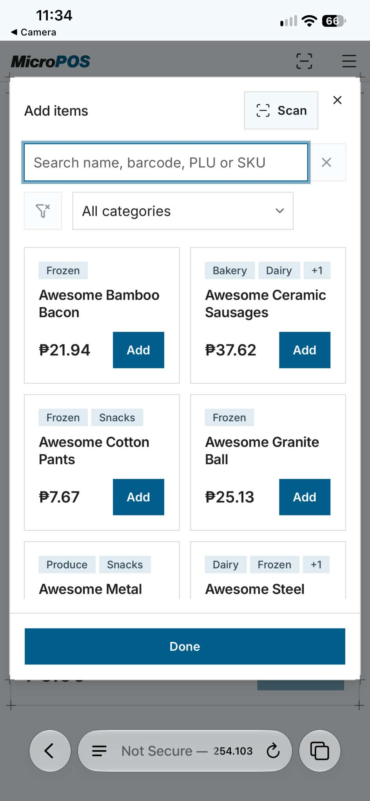
  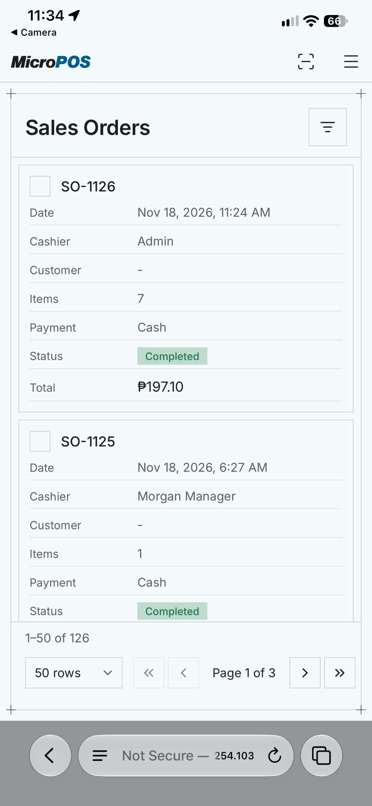
  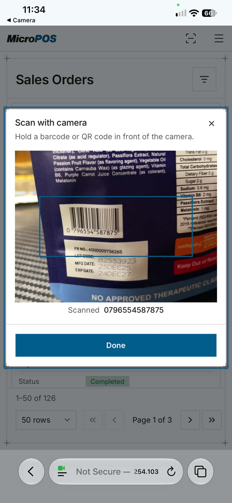
</p>
<p align="center">Add items, sales orders, camera barcode scan</p>

## Stack

| Package | Path | Tech |
| --- | --- | --- |
| `@micropos/core` | `packages/core` | Pure TypeScript business logic (pricing, tax, cart, inventory, auth, reports) |
| `@micropos/theme` | `packages/theme` | Shared design tokens and CSS |
| `@micropos/desktop` | `apps/desktop` | Electron 45, Electron Forge 8, Angular 22, Tailwind 4, Spartan UI, SQLite (better-sqlite3 + Drizzle) |
| `@micropos/mobile` | `apps/mobile` | Expo + React Native, connects to the desktop over LAN |
| `@micropos/web` | `apps/web` | Planned NestJS backend (Docker) |

## Requirements

- Node 24 (see `.nvmrc`)
- pnpm via corepack (`corepack enable`)
- Inno Setup 6 for the Windows installer
- Android SDK for mobile development builds

## Getting started

```sh
pnpm install
pnpm db:migrate --seed
pnpm dev
```

## Commands

| Command | Description |
| --- | --- |
| `pnpm dev` / `pnpm dev:desktop` | Build core and theme, run the desktop app |
| `pnpm dev:mobile` | Build core and theme, start Metro |
| `pnpm build` | Build every package |
| `pnpm test` | Run all tests |
| `pnpm typecheck` | Type check all packages |
| `pnpm make:desktop` | Package desktop installers into `apps/desktop/out/make/` (Inno Setup `.exe` on Windows, rpm and zip on Linux) |
| `pnpm db:migrate [--fresh] [--seed]` | Run desktop database migrations |
| `pnpm db:seed` | Seed dummy data |
| `pnpm db:generate` | Generate a migration from the Drizzle schema |
| `docker compose up` | Build and run the backend |

## Architecture notes

- `packages/core` has no platform imports. Apps implement platform specifics (storage, printing) behind its interfaces.
- Money is stored as integer minor units (cents).
- SQLite lives in Electron's main process; the renderer reaches it over IPC.
- The desktop runs a LAN server (HTTPS + WebSocket, self-signed certificate). Phones use it from a browser, or pair the mobile app by QR code.
- Database ERD: [`docs/erd.png`](docs/erd.png) (source `docs/erd.mmd`).

More detail in each app's `CLAUDE.md`.
